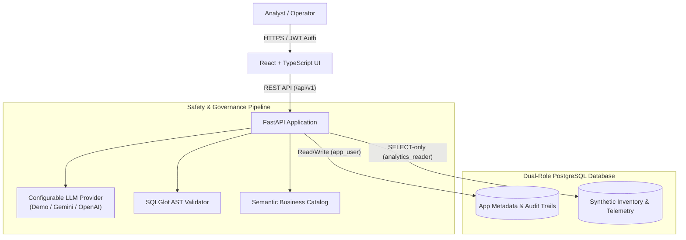

# QueryTrust AI — Enterprise Natural Language Analytics Workbench

[](https://www.python.org/)
[](https://fastapi.tiangolo.com/)
[](https://react.dev/)
[](https://www.typescriptlang.org/)
[](https://www.postgresql.org/)
[](https://github.com/tobymao/sqlglot)
[](https://scikit-learn.org/)
[](https://www.docker.com/)

QueryTrust AI is an enterprise-grade, read-only natural-language analytics workbench designed for networking hardware inventory, service incidents, and telemetry data. It translates user questions into safe, validated PostgreSQL queries, profiles data quality across 6 diagnostic integrity rules, detects multi-metric telemetry outliers using an unsupervised machine-learning IsolationForest model, and rigorously benchmarks performance against a versioned 37-case regression test suite.

> **Governance Notice:** QueryTrust AI uses strictly synthetic educational data (5,000 devices, 50 sites, 6,000 service incidents, 25,000 telemetry readings). It contains no real customer data, real corporate telemetry, or claims of affiliation with Cisco or any hardware vendor.

---

## 🌟 Key Capabilities

- **Governed Natural-Language Translation:** Converts queries like *"How many active devices are in each region?"* into safe SQL previews.
- **SQLGlot AST Safety Guard:** Parses candidate SQL into PostgreSQL abstract syntax trees, enforcing single-statement SELECTs, table allowlists, system catalog bans, dangerous function bans, and automatic row-clamping.
- **Dedicated Read-Only Execution Role:** Candidate SQL executes strictly through a PostgreSQL `analytics_reader` role in a read-only transaction with statement timeouts. Raw client SQL is never executed.
- **Disambiguation & Clarification:** Detects ambiguous phrases (`high-risk`, `unhealthy`) and prompts users with structured disambiguation choices rather than generating speculative SQL.
- **Out-of-Domain Detection:** Politely declines non-inventory queries (`revenue`, `churn`, `salary`) without fabricating answers.
- **Data Quality Profiler:** Read-only diagnostics across 6 integrity checks with weighted health scoring and sample record inspection.
- **Telemetry Anomaly Detection:** Scikit-learn `IsolationForest` scoring multidimensional telemetry (`cpu_percent`, `memory_percent`, `temperature_c`, `packet_loss_percent`, `latency_ms`). Prominently disclaims failure probability.
- **Evaluation Lab & Regression Benchmark:** 37 versioned test cases across 9 categories with offline deterministic execution and latency profiling.
- **Role-Based Access Control (RBAC):** Hierarchical roles (`admin`, `analyst`, `viewer`) with session ownership isolation and audit logging.

---

## 🏗️ Architecture Overview



For detailed architectural specifications, read [`docs/ARCHITECTURE.md`](docs/ARCHITECTURE.md).

---

## 🚀 Quick Start Guide

### Prerequisites
- Python 3.11+
- Node.js 18+ & npm
- PostgreSQL 15+ (or Docker)

### Option 1: Docker Compose (Recommended)
```bash
# Clone the repository
git clone https://github.com/kashish-sachdeva-ds/querytrustai.git
cd querytrustai

# Launch database, backend, and frontend
docker-compose up --build
```
- Frontend UI: `http://localhost:5173`
- Backend API Docs: `http://localhost:8000/docs`
- Health Probe: `http://localhost:8000/health`

### Option 2: Local Development

#### 1. Setup Database
```bash
# Connect to PostgreSQL and execute the role setup script
psql -U postgres -f scripts/setup_db.sql
```

#### 2. Setup Backend
```bash
cd backend

# Create and activate virtual environment
python -m venv .venv
source .venv/bin/activate  # On Windows: .venv\Scripts\activate

# Install dependencies
pip install -e .

# Run migrations and seed synthetic inventory
alembic upgrade head
python -m app.seed.seed_data

# Start backend server
python -m uvicorn app.main:app --port 8000 --reload
```

#### 3. Setup Frontend
```bash
cd frontend

# Install dependencies and start Vite dev server
npm install
npm run dev
```

---

## 🔐 Demo Credentials

| Role | Email | Password | Permissions |
|---|---|---|---|
| **Admin** | `admin@querytrust.local` | `AdminPass123!` | Full administration, user roles, evaluation suite execution |
| **Analyst** | `analyst@querytrust.local` | `AnalystPass123!` | Ask Data workbench, query execution, data quality profiling |
| **Viewer** | `viewer@querytrust.local` | `ViewerPass123!` | Read-only dashboards and device explorer |

---

## 🧪 Testing & Verification

QueryTrust AI includes 95 automated unit and integration tests covering security, AST validation, RBAC, query preview, execution, data quality, anomaly detection, and evaluation:

```bash
# Run backend test suite
cd backend
python -m pytest tests/ -v
# Output: 95 passed in ~4.2s

# Verify frontend production build
cd frontend
npm run build
# Output: built cleanly with zero TypeScript errors
```

### CLI Benchmark Runner
Run the 37-case regression benchmark directly from the terminal:
```bash
# Linux / macOS
./scripts/run_evaluation.sh guarded

# Windows PowerShell
.\scripts\run_evaluation.ps1 -Mode guarded
```

---

## 📚 Documentation Index

- [`docs/ARCHITECTURE.md`](docs/ARCHITECTURE.md) — Multi-layer system design, data flow, and isolation model.
- [`docs/API_CONTRACT.md`](docs/API_CONTRACT.md) — Complete REST API endpoint contracts and Pydantic schemas.
- [`docs/SECURITY.md`](docs/SECURITY.md) — Security invariants, AST validation rules, and threat mitigation matrix.
- [`docs/EVALUATION_PLAN.md`](docs/EVALUATION_PLAN.md) — Benchmark suite methodology, 37 test cases, and metrics.
- [`docs/DEMO_SCRIPT.md`](docs/DEMO_SCRIPT.md) — Guided step-by-step evaluator tour across all features.
- [`docs/BUILD_STATUS.md`](docs/BUILD_STATUS.md) — Truthful audit log of completed milestones, test outputs, and artifacts.

---

## 📄 License
This project is licensed under the MIT License for educational and demonstration purposes.
