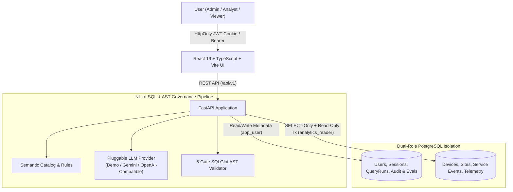

# QueryTrust AI — Governed Natural-Language Analytics Workbench

[](https://www.python.org/)
[](https://fastapi.tiangolo.com/)
[](https://react.dev/)
[](https://www.typescriptlang.org/)
[](https://www.postgresql.org/)
[](https://github.com/tobymao/sqlglot)
[](https://scikit-learn.org/)
[](https://www.docker.com/)

**QueryTrust AI** is a full-stack, governed, read-only natural-language analytics workbench built for networking hardware inventory, service events, and device telemetry. It translates plain-English questions into schema-constrained PostgreSQL queries, enforces a 6-gate SQLGlot Abstract Syntax Tree (AST) safety guard before and during execution, profiles data quality across 6 deterministic rules, flags multivariate telemetry outliers with `IsolationForest`, and verifies behavior against a versioned 37-case regression benchmark.

> **Governance Notice:** QueryTrust AI uses strictly synthetic educational data (`5,000` devices, `50` sites, `6,000` service incidents, `25,000` telemetry readings). It contains no real customer data, real corporate telemetry, or claims of affiliation with Cisco or any hardware vendor.

---

## 🌟 Key Capabilities

- **Governed NL-to-SQL & Semantic Catalog:** Translates natural-language questions using a central semantic catalog (`devices`, `sites`, `service_events` in sandbox mode, or introspected tables in connected workspaces) with normalized business definitions (`active_device`, `open_service_event`, `warranty_expiring_in_days`).
- **Two-Stage Preview-Then-Execute Contract:**
  - `POST /api/v1/analytics/preview` translates and AST-validates candidate SQL, stores a `QueryRun` record, and returns an opaque `query_run_id` UUID — **never executing SQL against business tables**.
  - `POST /api/v1/analytics/execute` accepts **only** a server-issued `query_run_id` (raw client SQL is rejected by schema validation), enforces single-use row locking and owner-only authorization, and re-validates the AST right before execution.
- **6-Gate SQLGlot AST Safety Guard:** Parses candidate SQL in PostgreSQL dialect (`sqlglot.parse(..., read="postgres")`) and enforces:
  1. `single_statement` — rejects empty, unparseable, or multi-statement (`;`) injections.
  2. `select_only` — requires `SELECT`/`UNION` roots and walks the full AST to block DDL/DML, `SELECT INTO`, and non-SELECT CTEs.
  3. `table_allowlist` — restricts tables to the approved allowlist and blocks CTE name-shadowing bypasses (`users`, `query_runs`, `pg_roles`, etc.).
  4. `schema_isolation` — blocks `pg_catalog`, `information_schema`, `pg_toast`, and non-`public` schemas.
  5. `prohibited_functions` — blocks dangerous PostgreSQL functions (`pg_sleep`, `pg_read_file`, `dblink`, `current_setting`, etc.), including schema-qualified calls.
  6. `row_limit_clamping` — automatically applies `LIMIT 200` when omitted/invalid and clamps excessive limits to `LIMIT 500`.
- **Dedicated Read-Only Execution Role:** Analytics queries execute through a PostgreSQL `analytics_reader` role (`SELECT`-only grants on business tables) inside `SET TRANSACTION READ ONLY` with a `5`-second `statement_timeout`.
- **Disambiguation & Out-of-Domain Guardrails:** Detects ambiguous terms (`high-risk`, `unhealthy`) and prompts users with clickable clarification choices (`clarification_needed`) instead of guessing SQL; politely declines non-schema concepts (`revenue`, `churn`, `salary`) as `unsupported`.
- **Query Studio & Conversation Sessions:** Interactive workbench (`AskDataView`) with idempotent chat sessions (`Idempotency-Key`), optional SSE stage streaming (`/api/v1/chat/stream`), Red-Team attack simulation presets, an inspectable 6-gate AST Safety drawer (`AstInspectorPanel`), Viewer-role SQL masking, and sortable CSV/JSON result exports (`VirtualizedResultsGrid`).
- **Read-Only Data Quality Profiler:** Deterministic diagnostic rules (`DQ-001` through `DQ-006`) detecting missing warranties/serials, inverted warranty/install dates, duplicate serials, inconsistent categories, unapproved statuses, and telemetry out-of-range violations without modifying rows.
- **Telemetry Outlier Monitor (ML):** Scikit-learn `StandardScaler` + `IsolationForest` pipeline scoring 5 telemetry features (`cpu_percent`, `memory_percent`, `temperature_c`, `packet_loss_percent`, `latency_ms`) with tracked model versions. Scores are explicitly labeled as statistical outlier indicators, **not** device failure probabilities.
- **Evaluation Lab & Regression Benchmark:** 37 manually reviewed test cases across 9 categories (`simple_filter`, `aggregation`, `date_range`, `join`, `semantic`, `multi_turn`, `ambiguity`, `unsupported`, `security`) comparing `guarded` vs. `baseline` pipelines.
- **RBAC, Workspaces, External Data Sources & Webhooks:** Role-based access control (`admin`, `analyst`, `viewer`), workspace access requests, Fernet-encrypted external PostgreSQL data sources with SSRF protection and schema introspection, and HMAC-signed Discord/Slack/JSON alert webhooks.

---

## 🏗️ Architecture Overview



### Workbench Views
| View | Component | Purpose |
|---|---|---|
| **Fleet Overview** | `OverviewView` | Live KPI metrics, warranty buckets, status/severity distributions, and recent events |
| **Query Studio** | `AskDataView` | Natural-language workbench, clarification chips, SQL/AST safety drawer, and results grid |
| **Data Catalog** | `DevicesView` | Paginated device explorer (`25`/`50`/`100`), canonical filters, device drawer, and schema ERD |
| **Data Health** | `DataQualityView` | 6-rule deterministic integrity diagnostics (`DQ-001`–`DQ-006`) and sample inspection |
| **Anomalies** | `AnomalyMonitorView` | `IsolationForest` multivariate telemetry outlier scan and model version metadata |
| **AST Safety Proof** | `EvaluationLabView` | 37-case regression benchmark (`guarded` vs. `baseline`), category metrics, and case inspection |
| **Sources & Kernel** | `DataSourcesView` | External PostgreSQL connection management, schema introspection, and dual-role topology |
| **Audit History** | `QueryHistoryView` | Paginated query execution history, latency/row counts, and helpfulness feedback |
| **People & Access** | `AdminView` | User role/status administration, workspace invites, access requests, audit logs, and webhooks |

For detailed specifications, see [`docs/ARCHITECTURE.md`](docs/ARCHITECTURE.md) and [`docs/SECURITY.md`](docs/SECURITY.md).

---

## 🚀 Quick Start Guide

### Prerequisites
- Python 3.11+
- Node.js 18+ & npm
- PostgreSQL 15+ (PostgreSQL 16 recommended, or Docker)

### Environment Configuration
Copy the example environment file before starting locally or customizing providers:
```bash
cp .env.example .env
```
Key variables in [`.env.example`](.env.example):
- `LLM_PROVIDER`: `demo` (offline deterministic rule engine, default), `gemini` (requires `GEMINI_API_KEY`), or `openai_compatible` (requires `OPENAI_API_KEY` and optional `OPENAI_BASE_URL`).
- `DEMO_MODE`: `true` enables local demo accounts and quick-login helpers; set to `false` in production.
- `DATABASE_URL` & `READONLY_DATABASE_URL`: separate PostgreSQL credentials for `app_user` and `analytics_reader`.

### Option 1: Docker Compose (Recommended)
```bash
docker compose up --build
```
- Frontend UI: `http://localhost:5173` (and `http://localhost:80`)
- Backend API Docs: `http://localhost:8000/docs`
- Health & Readiness Probes: `http://localhost:8000/health` and `http://localhost:8000/ready`

### Option 2: Local Development

#### 1. Setup PostgreSQL Database & Roles
```bash
psql -U postgres -f scripts/setup_db.sql
```

#### 2. Setup Backend, Migrations & Seed Data
```bash
cd backend
python -m venv .venv
# Linux / macOS:
source .venv/bin/activate
# Windows PowerShell:
# .venv\Scripts\Activate.ps1

pip install -e .
alembic upgrade head
python -m app.seed.seed_data

python -m uvicorn app.main:app --port 8000 --reload
```
*(Convenience seed helpers are also available via `./scripts/seed.sh` or `.\scripts\seed.ps1`.)*

#### 3. Setup Frontend
```bash
cd frontend
npm install
npm run dev
```
Open `http://localhost:5173`.

---

## 🔐 Demo Credentials (Local Development Only)

When `DEMO_MODE=true`, the following synthetic accounts are seeded via environment defaults:

| Role | Email | Default Password | Permissions |
|---|---|---|---|
| **Admin** | `admin@querytrust.local` | `AdminPass123!` | Full workspace admin, user roles, data sources, evaluation benchmark |
| **Analyst** | `analyst@querytrust.local` | `AnalystPass123!` | Query Studio preview/execute, SQL disclosure, data quality & anomaly scans |
| **Viewer** | `viewer@querytrust.local` | `ViewerPass123!` | Read-only dashboards, device catalog, governed answers (raw SQL masked) |

---

## 🧪 Testing & Verification

The repository includes **151 automated backend test functions across 21 test files** in [`backend/tests/`](backend/tests) covering SQLGlot AST security rules, LLM provider contracts, two-stage preview/execute invariants, RBAC, session ownership, data quality rules, `IsolationForest` anomaly detection, evaluation benchmarks, external data sources, and webhooks.

```bash
# Backend unit and integration tests (requires PostgreSQL seeded test environment)
cd backend
python -m pytest tests/ -v

# Frontend design-token hex audit, Oxlint, and TypeScript + Vite production build
cd frontend
npm run lint:hex
npm run lint
npm run build
```

### CLI Benchmark Runner
Run the 37-case regression benchmark (`guarded` or `baseline`) from the command line:
```bash
# Linux / macOS
./scripts/run_evaluation.sh guarded

# Windows PowerShell
.\scripts\run_evaluation.ps1 -Mode guarded
```

---

## 📚 Documentation Index

- [`PROJECT_SPEC.md`](PROJECT_SPEC.md) — Product, architecture, and security specification.
- [`docs/PRD.md`](docs/PRD.md) — Product requirements, user stories, and schema contract.
- [`docs/ARCHITECTURE.md`](docs/ARCHITECTURE.md) — Layered system design, data flow, and dual-role isolation.
- [`docs/API_CONTRACT.md`](docs/API_CONTRACT.md) — REST API endpoint contracts and Pydantic schemas.
- [`docs/SECURITY.md`](docs/SECURITY.md) — Security invariants, AST validation rules, and threat mitigation matrix.
- [`docs/EVALUATION_PLAN.md`](docs/EVALUATION_PLAN.md) — 37-case benchmark methodology and metric definitions.
- [`docs/DEMO_SCRIPT.md`](docs/DEMO_SCRIPT.md) — Guided evaluator walkthrough across application features.
- [`docs/BUILD_STATUS.md`](docs/BUILD_STATUS.md) — Milestone audit log and verification history.

---

## 📄 License
This project is licensed under the MIT License for educational and demonstration purposes.
