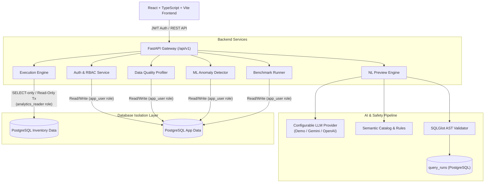

# QueryTrust AI — System Architecture

## 1. System Overview

QueryTrust AI is an enterprise-grade, read-only natural-language analytics workbench for network inventory and telemetry data. It translates natural language questions into safe, validated PostgreSQL queries, provides automated data quality diagnostics, scores multi-metric telemetry outliers using machine learning, and evaluates accuracy against a versioned 37-case regression benchmark.



---

## 2. Layered Architecture

### 2.1 Presentation Layer (Frontend)
- **Framework:** React 18, TypeScript, Vite.
- **Styling:** Custom CSS design system with dark enterprise theme, HSL palette tokens, responsive grid layouts, and keyboard accessibility.
- **Key Views:**
  - `OverviewView`: Fleet-wide KPIs, asset status distributions, hardware types, and severity breakdowns.
  - `DevicesView`: Paginated (25/50/100) searchable device inventory explorer with hardware details and modal inspection.
  - `AskDataView`: Natural language query workbench with chat sessions, starter prompts, live SQL preview, AST safety checklists, and query execution.
  - `QueryHistoryView`: User query audit trail, execution durations, row counts, and binary feedback recording.
  - `DataQualityView`: Automated profiling across 6 integrity rules, weighted health score gauge, and sample defect inspection.
  - `AnomalyMonitorView`: IsolationForest telemetry outlier scoring across 25,000 synthetic readings with governance disclaimer.
  - `EvaluationLabView`: Versioned regression benchmark runner comparing guarded vs. baseline pipelines with category breakdowns.
  - `AdminView`: User role assignment (`admin`, `analyst`, `viewer`), account activation, and audit logs.

### 2.2 Application Gateway & Security Layer (Backend)
- **Framework:** FastAPI, Python 3.11+.
- **Authentication:** OAuth2 password bearer tokens using cryptographically signed HMAC-SHA256 JWTs with bounded expiry (60 minutes).
- **Authorization:** Role-Based Access Control (RBAC):
  - `admin`: Full system access, user administration, data quality runs, evaluation lab execution.
  - `analyst`: Inventory exploration, Ask Data preview/execution, feedback submission, data quality diagnostics.
  - `viewer`: Read-only access to dashboard, devices, findings, and evaluation history.
- **Session & Ownership Isolation:** Non-admin users can access only their own chat sessions and query execution histories.

### 2.3 Natural Language Translation & Safety Pipeline
1. **Semantic Catalog (`core/semantic_catalog.py`):** Authoritative mappings for business terms (`active`, `open service event`, `warranty horizon`), table schemas, foreign key relationships, and ambiguity keywords.
2. **LLM Provider Engine (`core/llm_provider.py`):**
   - Pluggable provider interface supporting `DemoLLMProvider` (offline, deterministic rule engine), `GeminiLLMProvider` (Google Gemini API), and `OpenAICompatibleLLMProvider`.
   - Structured JSON output conforming to Pydantic schemas.
   - Ambiguity detection: Questions containing ambiguous terms like `high-risk` or `unhealthy` trigger clarification questions rather than speculative SQL.
   - Domain boundary enforcement: Out-of-domain questions (`revenue`, `churn`, `salary`) are politely declined.
3. **SQLGlot AST Validator (`core/sql_validator.py`):**
   - Parses candidate SQL using PostgreSQL dialect.
   - Enforces single-statement invariant (blocks semicolon chaining).
   - Enforces read-only `SELECT` (blocks `INSERT`, `UPDATE`, `DELETE`, `DROP`, `ALTER`, `CREATE`, `TRUNCATE`, `GRANT`, `REVOKE`).
   - Restricts tables to approved allowlist (`devices`, `sites`, `service_events`).
   - Blocks access to system catalogs (`pg_catalog`, `information_schema`).
   - Blocks dangerous and resource-intensive functions (`pg_sleep`, file operations, administrative calls).
   - Clamps result rows automatically (default `LIMIT 200`, maximum `LIMIT 500`).

### 2.4 Dual-Role Database Access Model
To ensure absolute defense-in-depth, PostgreSQL utilizes two distinct database roles:

| Database Role | Permissions | Used By |
|---|---|---|
| `app_user` | Full CRUD on application metadata tables (`users`, `query_runs`, `chat_sessions`, `chat_messages`, `data_quality_runs`, `data_quality_findings`, `ml_model_versions`, `evaluation_runs`) | Application backend services |
| `analytics_reader` | Strictly `SELECT` on business data tables (`devices`, `sites`, `service_events`, `telemetry_readings`). No write permissions. | Natural-language query execution engine |

### 2.5 Critical Execution Invariant
The Natural-Language Execution API (`POST /api/v1/analytics/execute`) **never accepts raw SQL from the client**. It accepts exclusively a server-stored, validated `query_run_id`. Before execution, the backend verifies:
1. The user owns the query run (or has `admin` role).
2. The query run has status `previewed`.
3. The query SQL passes AST re-validation.
4. Execution occurs in a read-only transaction using `analytics_reader` with statement timeouts.

---

## 3. Data Flow

```text
User Question
     │
     ▼
[ POST /api/v1/analytics/preview ]
     │
     ├── 1. Check Ambiguity / Unsupported Terms (Semantic Catalog)
     │       └── If ambiguous: Return intent_status='clarification_needed'
     │       └── If out-of-domain: Return intent_status='unsupported'
     │
     ├── 2. Generate Candidate SQL (LLM Provider)
     │
     ├── 3. AST Validation & Sanitize (SQLGlot)
     │       ├── Single statement check
     │       ├── Read-only SELECT check
     │       ├── Table allowlist check
     │       ├── System catalog / dangerous function check
     │       └── Row limit clamp (LIMIT 200)
     │
     ├── 4. Store Preview Record (PostgreSQL query_runs table)
     │
     └── 5. Return Structured Preview with query_run_id (NO execution)

User Reviews Preview & Clicks "Execute"
     │
     ▼
[ POST /api/v1/analytics/execute ]
     │
     ├── 1. Verify User Ownership & Role
     ├── 2. Fetch Stored SQL by query_run_id
     ├── 3. Re-validate AST
     ├── 4. Open Read-Only Transaction with analytics_reader Role
     ├── 5. Execute with 5s Statement Timeout
     ├── 6. Truncate Results to 200 Rows if Needed
     ├── 7. Determine Chart Recommendation (metric, bar, pie, table)
     └── 8. Record Row Count, Duration, and Return Results
```
