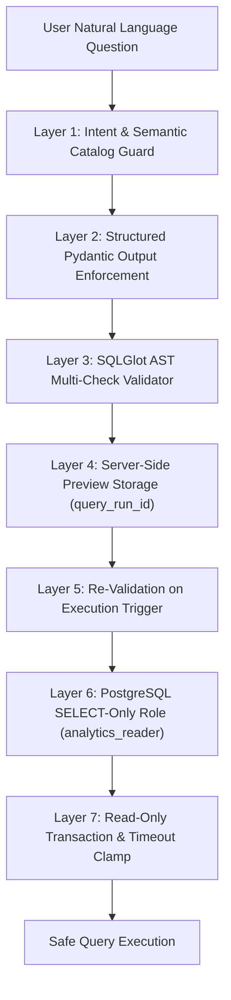

# QueryTrust AI — Security Architecture & Threat Model

## 1. Security Invariants

1. **Read-Only Analytics Pipeline:** The natural-language analytics pathway is strictly read-only for every user role, including `admin`.
2. **Untrusted LLM Output:** Large Language Model outputs are treated as untrusted user inputs. System instructions and prompts are NOT security boundaries.
3. **No Arbitrary SQL Execution:** The application exposes NO endpoint accepting arbitrary SQL strings from the frontend. Query execution is allowed exclusively via a server-generated, validated `query_run_id`.
4. **Defense-in-Depth Database Permissions:** Database queries generated via the natural language path execute through a dedicated PostgreSQL user (`analytics_reader`) with SELECT-only grants. Even if an AST validator bypass occurred, the database engine prohibits any modification.
5. **No Synthetic Secret Exposure:** Passwords, API tokens, JWT keys, and connection strings are never returned in API payloads or logged in plain text.
6. **No Real Customer / Proprietary Data:** All data in QueryTrust AI is deterministically generated synthetic educational data.

---

## 2. Multi-Layer Security Architecture

---

## 3. SQLGlot Abstract Syntax Tree (AST) Validation

Before candidate SQL is accepted for preview, `app/core/sql_validator.py` parses the statement using the PostgreSQL dialect and applies six deterministic checks:

| Check | Rule | Violation Behavior |
|---|---|---|
| `single_statement` | Exactly one SQL expression permitted. | Rejects multiple statements separated by semicolons (e.g., `SELECT 1; DROP TABLE devices;`). |
| `select_only` | Expression must be an instance of `exp.Select`. | Rejects `INSERT`, `UPDATE`, `DELETE`, `DROP`, `ALTER`, `CREATE`, `TRUNCATE`, `GRANT`, `REVOKE`. |
| `table_allowlist` | Tables referenced must be within `{'devices', 'sites', 'service_events'}`. Dynamic CTE aliases are tracked and allowed. | Rejects references to `users`, `query_runs`, `data_quality_findings`, etc. |
| `schema_allowlist` | Queries cannot reference system schemas (`pg_catalog`, `information_schema`). | Rejects metadata enumeration attacks (e.g., `SELECT * FROM pg_catalog.pg_tables`). |
| `function_allowlist` | Prohibits administrative, delay, and filesystem functions. | Rejects `pg_sleep`, `pg_read_file`, `system()`, `version()`, etc. |
| `row_limit` | Queries must not return unbounded datasets. | Automatically injects `LIMIT 200` if omitted; clamps excessive limits to `LIMIT 500`. |

---

## 4. Database-Level Isolation & Permissions

QueryTrust AI separates metadata operations from analytics queries across two distinct database users:

### `app_user` (Application Service Account)
- Schema: `public`
- Privileges: Full CRUD on application metadata (`users`, `query_runs`, `chat_sessions`, `chat_messages`, `data_quality_runs`, `data_quality_findings`, `ml_model_versions`, `evaluation_runs`).
- Never used to execute natural-language queries.

### `analytics_reader` (Analytics Execution Account)
- Schema: `public`
- Privileges: Strictly `SELECT` on business data tables (`devices`, `sites`, `service_events`, `telemetry_readings`).
- Denied: `INSERT`, `UPDATE`, `DELETE`, `TRUNCATE`, `REFERENCES`, `TRIGGER`, `CREATE`.
- Execution Session Settings:
  - `SET TRANSACTION READ ONLY`
  - `SET statement_timeout = 5000` (5-second execution limit)

---

## 5. Authentication, RBAC & Ownership Isolation

- **Password Hashing:** Passwords are salted and hashed using bcrypt (12 rounds) via `passlib`.
- **JWT Signing:** Access tokens are signed using HMAC-SHA256 (`HS256`) with a 60-minute lifetime.
- **Role Hierarchy:**
  - `viewer`: Can explore inventory and view findings. Cannot generate SQL previews, execute queries, or trigger evaluations.
  - `analyst`: Can explore inventory, submit natural-language queries, execute previews, and run data quality profiling.
  - `admin`: Can manage users, adjust roles, view audit logs, and trigger evaluation runs.
- **Resource Ownership:** Chat sessions and query runs are bound to `user_id`. Non-admin users attempting to inspect or execute another user's session receive `403 Forbidden`.

---

## 6. Threat Mitigation Matrix

| Threat Category | Potential Vector | QueryTrust AI Mitigation |
|---|---|---|
| **SQL Injection (SQLi)** | Prompt injection directing LLM to append `DROP TABLE` or `DELETE` | SQLGlot AST validator blocks non-SELECT statements. Database role `analytics_reader` has zero DDL/DML write grants. |
| **Denial of Service (DoS)** | Queries requesting billions of rows or using `pg_sleep` | Row clamping automatically adds `LIMIT 200`. AST validator blocks sleep functions. Database enforces 5-second `statement_timeout`. |
| **Data Exfiltration** | Enumerating user passwords or database metadata | Table allowlist blocks `users` and `query_runs`. Schema guard blocks `pg_catalog` and `information_schema`. |
| **Tampering** | Modifying generated SQL before execution in browser | Client NEVER sends SQL to execution endpoint. Execution accepts only server-stored `query_run_id` and re-validates the AST. |
| **Privilege Escalation** | Low-privilege user executing admin commands or viewing other sessions | Server-side FastAPI dependencies enforce RBAC and user ownership checks on every route. |
| **Secret Leaks** | Credentials committed to git or printed in logs | `.env` is gitignored; `.env.example` contains placeholders; logging config omits request secrets and database connection strings. |
